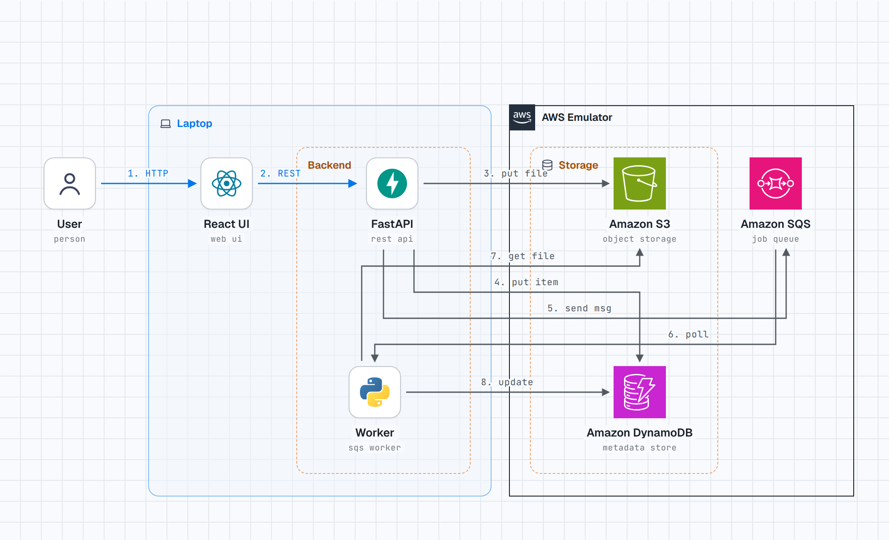

# File Processing Pipeline on AWS Emulator (PoC)

A small end-to-end proof of concept: a REST API accepts file uploads, stores
each file in S3, writes a `PENDING` record to DynamoDB and enqueues a job on
SQS; a background worker picks the job up, reads the file back, computes its
size, line count, word count and SHA-256, and flips the record to `PROCESSED`.
Everything runs on your laptop against
[AWS Emulator](https://docs.aws.amazon.com/emulator/latest/userguide/) — no AWS
account, no network calls to AWS, no cost.

```mermaid
flowchart LR
    Client -->|POST /files| API[FastAPI api]
    API -->|put object| S3[(S3 bucket)]
    API -->|put item PENDING| DDB[(DynamoDB table)]
    API -->|send message| SQS[["SQS queue"]]
    SQS -->|long-poll| Worker[worker]
    Worker -->|get object| S3
    Worker -->|update PROCESSED + results| DDB
    Client -->|GET /files/{id}| API
```

ASCII version:

```
  Client --upload--> [API] --put--> (S3)
                      [API] --PENDING--> (DynamoDB)
                      [API] --{file_id}--> [SQS] --poll--> [worker]
                                                        |--get--> (S3)
                                                        |--PROCESSED--> (DynamoDB)
  Client --status/results--> [API]
```

Rendered version with official logos (self-contained, works offline:
[HTML](docs/architecture.html) · [dark PNG](docs/architecture-dark.png)):



## What AWS Emulator is

AWS Emulator is AWS's own local emulator of the AWS APIs: one command,
`aws-emulator`, that serves S3, DynamoDB, SQS and other service APIs over
HTTPS on `https://127.0.0.1:9297` with a per-run self-signed certificate. The
AWS CLI and SDKs work unchanged once a few environment variables point them at
it. It has no GUI; you talk to it through the CLI, SDKs, or this app.

Limitations that shape this PoC (from the
[docs](https://docs.aws.amazon.com/emulator/latest/userguide/what-is-service.html),
verified where noted):

- **In-memory state.** Everything vanishes when the emulator stops, so
  `make bootstrap` (re)creates the bucket, table and queue after every start.
- **One account (`000000000000`) and one Region per emulator.** We use
  `us-east-1` everywhere.
- **No IAM enforcement.** Signatures are checked, but identity/resource
  policies are not evaluated like AWS — never use it to test security.
- **Not for production.** Not tested for load or long-running use; an
  independent review reported caps around 64 MiB per bucket and 1,000 messages
  per queue (not re-verified here — our payloads stay under 1 MiB).
- **Fidelity varies by service.** Unimplemented operations return HTTP 501
  `NotImplemented`. The S3/DynamoDB/SQS calls used here all worked (see
  [Findings](#findings-emulator-quirks-observed)).

## Prerequisites

- Linux with `apt` (Debian/Ubuntu), `curl`, `make`, Python 3.10+
  (developed with 3.14).
- AWS CLI v2. Check with `aws --version` (this machine has `aws-cli/2.40.3`).
  If it is missing, install it from the
  [official instructions](https://docs.aws.amazon.com/cli/latest/userguide/getting-started-install.html)
  (download `awscliv2.zip`, unzip, `sudo ./aws/install`) — those steps are
  quoted from AWS, not re-run here.
- Optional: Docker, for the containerized variant (`docker --version`).
- AWS Emulator itself — see [Install](#1-install-and-verify-the-emulator).

Check what you have:

```console
$ python3 --version && aws --version && aws-emulator -v
Python 3.14.4
aws-cli/2.40.3 Python/3.14.8 Linux/7.0.0-43-generic exe/x86_64.ubuntu.26
Version: 1.0.385
Release date: 2026.11.14
Commit: 813af480bf7f16d5418b64e4f5644a74a7da11c5
```

## Quickstart

```console
$ make install-emulator     # Debian/Ubuntu; no-op if already installed
$ make start-emulator       # no-op if already healthy
$ source scripts/env.sh && make setup && make bootstrap
$ make api                  # terminal 2 (leave running)
$ make worker               # terminal 3 (leave running)
$ make demo && make test    # terminal 1
```

`make demo` uploads a sample file and polls until it flips
`PENDING -> PROCESSED`; `make test` runs the 24 unit, guard and integration
tests. Read on for what each step does.

## Step by step

### 1. Install and verify the emulator

If `aws-emulator -v` already prints a version, skip the install. Otherwise,
on Debian/Ubuntu (amd64; use `_arm64.deb` on ARM):

```console
$ scripts/install_emulator.sh
```

which downloads `aws-emulator_amd64.deb` from
`https://downloads.aws.com/aws-emulator/packages/aws-emulator/LTS/latest/`
and installs it with `apt-get`. With `--verify` it additionally downloads the
`.sig` file and checks the GPG signature (key from
`https://downloads.aws.com/keys/gpg/current.asc`, fingerprint must be
`98BC F336 A3BE 53B7 34E9 67C5 2E5B F49B D940 F624`).

> Note: the install commands and fingerprint are quoted from the
> [official guide](https://docs.aws.amazon.com/emulator/latest/userguide/getting-started-linux.html).
> They were not re-run here because the emulator was already installed; only
> the script's syntax (`bash -n`) and its already-installed early exit path
> were verified. On macOS/Windows there is no native package: run the
> emulator in Docker from an image built with the Dockerfile in the AWS docs
> (mentioned here only, not implemented).

### 2. Start and stop the emulator

```console
$ make start-emulator
scripts/start_emulator.sh
emulator already running and healthy on port 9297; not starting another copy.
```

If the health check does not pass, the script starts
`aws-emulator --telemetry off` in the background (telemetry is on by default;
we keep it off), logs to `.run/emulator.log`, records `.run/emulator.pid`,
and waits up to 30 s for `ok`. After any (re)start, re-run `make bootstrap`
because emulator state is wiped.

```console
$ make stop-emulator         # stops ONLY the emulator this project started
```

### 3. Point your shell at the emulator

```console
$ source scripts/env.sh
AWS environment now points at the emulator (https://127.0.0.1:9297).
Verify: scripts/check_env.sh
```

This exports `AWS_ENDPOINT_URL`, `AWS_SHARED_CREDENTIALS_FILE`,
`AWS_CONFIG_FILE`, `AWS_CA_BUNDLE`, `NODE_EXTRA_CA_CERTS`,
`AWS_EC2_METADATA_DISABLED=true`, `AWS_DISABLE_HOST_PREFIX_INJECTION=true`,
`AWS_REGION`/`AWS_DEFAULT_REGION=us-east-1`, `AWS_PAGER=""`, and unsets any
real-credential variables. Every new terminal needs this sourced. Never touch
`~/.aws/emulator/9297/` (regenerated each start) or your real
`~/.aws/credentials`.

### 4. Health and environment check

```console
$ curl --cacert ~/.aws/emulator/9297/ca.pem https://127.0.0.1:9297/__admin/health
ok
$ make check
ok   - CA bundle exists: /home/tntra/.aws/emulator/9297/ca.pem
ok   - emulator health check returns 'ok'
ok   - AWS_SHARED_CREDENTIALS_FILE is set
ok   - AWS_CONFIG_FILE is set
ok   - AWS_CA_BUNDLE is set
ok   - AWS_REGION is set
ok   - sts get-caller-identity account is 000000000000 (emulator)
environment ready: this shell talks to the emulator
```

### 5. Create the resources

```console
$ make bootstrap
bucket 'poc-files' created
table 'poc-files' created, waiting for ACTIVE...
table 'poc-files' is ACTIVE
queue 'poc-file-jobs' created
bootstrap ok: account=000000000000
```

Safe to run repeatedly — existing resources are skipped, and each step waits
until the resource is usable.

### 6. Run the API and the worker

In two separate terminals (both with `source scripts/env.sh`):

```console
$ make api       # serves http://127.0.0.1:8000
$ make worker    # long-polls SQS; Ctrl-C stops it gracefully
```

Both refuse to start unless `sts get-caller-identity` returns account
`000000000000` (override: `ALLOW_REAL_AWS=1`).

Example session against the running API:

```console
$ curl -s http://127.0.0.1:8000/health
{"status":"ok","emulator_reachable":true,"account_id":"000000000000",
 "region":"us-east-1","resources":{"bucket":"poc-files","table":"poc-files",
 "queue":"poc-file-jobs"}}

$ echo "hello emulator" > hello.txt
$ curl -s -F "file=@hello.txt" http://127.0.0.1:8000/files
{"file_id":"9df1449634ee48c881390481cfa3cdcc","status":"PENDING"}

$ curl -s http://127.0.0.1:8000/files/9df1449634ee48c881390481cfa3cdcc
{"status":"PROCESSED","size_bytes":15,"word_count":2,"line_count":1,
 "filename":"hello.txt","content_type":"text/plain",
 "s3_key":"uploads/9df1449634ee48c881390481cfa3cdcc/hello.txt",
 "sha256":"96ec299d5a4f834c567c61fd7c4b2de4f7072b5998e9a5a7f6a54455dc74e849",
 "created_at":"2026-11-16T07:07:00.526035+00:00",
 "processed_at":"2026-11-16T07:07:00.594823+00:00",
 "file_id":"9df1449634ee48c881390481cfa3cdcc"}

$ curl -s http://127.0.0.1:8000/files | head -c 120   # list all items
$ curl -s -o copy.txt http://127.0.0.1:8000/files/<id>/download  # bytes identical
$ curl -s -o /dev/null -w "%{http_code}\n" -X DELETE http://127.0.0.1:8000/files/<id>
204
```

Or run the scripted version: `make demo` uploads a sample, polls until
`PROCESSED` (2 min timeout) and prints the result (`DEMO OK` on success).

### 7. Run the tests

```console
$ make test   # 24 passed: 9 processing + 6 guard + 9 integration
```

Integration tests talk to the live emulator using their own `poc-test-*`
resources (created and deleted by the suite), and skip with a clear message
if the emulator is unreachable or the account is not `000000000000`.

## API reference

| Method | Path | Description | Success | Errors |
|---|---|---|---|---|
| GET | `/health` | App status, emulator reachability, account id | 200 JSON | — |
| POST | `/files` | Multipart upload, field `file`; stores S3 + DynamoDB (`PENDING`) + SQS | 201 `{file_id, status}` | 413 over 1 MiB |
| GET | `/files` | List all items (Scan; fine for a PoC) | 200 JSON array | — |
| GET | `/files/{id}` | Item with status and results | 200 JSON | 404 unknown id |
| GET | `/files/{id}/download` | Stream the original bytes back from S3 | 200 file | 404 unknown id/object |
| DELETE | `/files/{id}` | Delete the S3 object and DynamoDB item | 204 empty | 404 unknown id |

## Data model

DynamoDB table (`TABLE_NAME`, on-demand billing): partition key **`file_id`
(String)**, no sort key. DynamoDB is schemaless — these are the attributes the
app writes:

| Attribute | Type | Written by | When |
|---|---|---|---|
| `file_id` | S (key) | API | upload |
| `filename`, `content_type`, `s3_key` | S | API | upload |
| `size_bytes` | N | API | upload |
| `status` | S | API, worker | `PENDING` → `PROCESSED` / `FAILED` |
| `created_at` | S | API | upload |
| `line_count`, `word_count` | N | worker | processed |
| `sha256`, `processed_at` | S | worker | processed |
| `error`, `failed_at` | S | worker | only if failed |

S3 objects live at `uploads/{file_id}/{filename}`; SQS messages are
`{"file_id": "<id>"}`.

## Configuration

| Variable | Default | Purpose |
|---|---|---|
| `BUCKET_NAME` | `poc-files` | S3 bucket for uploads |
| `TABLE_NAME` | `poc-files` | DynamoDB table (`file_id` string key, on-demand) |
| `QUEUE_NAME` | `poc-file-jobs` | SQS queue (visibility timeout 30 s) |
| `ALLOW_REAL_AWS` | `0` | `1` disables the emulator-account guard (real AWS!) |
| `API_PORT` | `8000` | uvicorn port (`make api`, `demo.sh` via `API_BASE`) |
| `AWS_REGION` | `us-east-1` | Region for all boto3 clients (emulator: one per process) |
| `EMULATOR_PORT` | `9297` | Port used by `env.sh` and the start/stop scripts |
| `API_BASE` | `http://127.0.0.1:$API_PORT` | `demo.sh` target override |
| `DEMO_TIMEOUT` | `120` | `demo.sh` poll timeout, seconds |

AWS endpoint/credentials/TLS come only from the standard AWS environment
(`AWS_ENDPOINT_URL`, `AWS_CONFIG_FILE`, `AWS_SHARED_CREDENTIALS_FILE`,
`AWS_CA_BUNDLE`, …) set by `scripts/env.sh`; nothing is hardcoded in `app/`.

## How it was built

Design decisions:

- **No hardcoded endpoint or credentials.** boto3 resolves both from the
  environment (verified: the generated `config`'s `endpoint_url` alone is
  enough, and we additionally set `AWS_ENDPOINT_URL` per the docs).
- **Account safety guard.** `app/aws.py:guard_emulator_account` runs at API
  startup (lifespan), worker startup and bootstrap; anything but account
  `000000000000` aborts unless `ALLOW_REAL_AWS=1`. Covered by 6 tests.
- **Idempotent bootstrap.** `app/bootstrap.py` skips existing resources and
  waits for the DynamoDB table to turn `ACTIVE`; safe to re-run after every
  emulator restart.
- **Pure processing function.** `app/processing.py:process_file_content`
  takes bytes and returns a dict — no AWS, 9 unit tests.
- **Worker `--once`.** `python -m app.worker --once` drains the queue and
  exits so integration tests are deterministic; the long-running loop adds
  graceful SIGINT/SIGTERM shutdown.
- **Queue URL looked up at runtime** via `get_queue_url`, never constructed.
  The emulator returns an `amazonaws.com` URL (see Findings); a dedicated
  test hooks boto3's `before-send` event to prove every request still hits
  `https://127.0.0.1:9297`.

```
.
├── app/
│   ├── __init__.py
│   ├── config.py       # env-var settings (fresh read per call, test-friendly)
│   ├── aws.py          # boto3 client factory + account guard
│   ├── processing.py   # pure compute: size/lines/words/sha256
│   ├── bootstrap.py    # idempotent bucket/table/queue creation
│   ├── main.py         # FastAPI app
│   └── worker.py       # SQS worker (loop + --once)
├── scripts/
│   ├── install_emulator.sh  # Debian/Ubuntu install (+ optional GPG --verify)
│   ├── start_emulator.sh    # background start w/ health wait (no-op if up)
│   ├── stop_emulator.sh     # stop only the PID-file emulator
│   ├── env.sh               # source: point shell at the emulator
│   ├── check_env.sh         # verify health, env vars, account
│   └── demo.sh              # upload -> poll PROCESSED -> print
├── tests/
│   ├── test_processing.py   # pure-function unit tests
│   ├── test_guard.py        # account guard (mocked STS)
│   └── test_integration.py  # live-emulator flow, locality proof, cleanup
├── frontend/                  # React + Vite UI (upload/list/results/download/delete)
│   ├── src/App.jsx          # the whole UI in one component
│   └── .env.example         # VITE_API_BASE override
├── docs/                      # rendered architecture diagram (HTML + light/dark PNG)
├── Dockerfile
├── docker-compose.yml       # api + worker, host networking (Linux)
├── Makefile
├── requirements.txt
├── requirements-dev.txt
└── README.md
```

## Docker variant (verified, Linux only)

The same image runs both services. Because the emulator listens on the host's
`127.0.0.1:9297`, the compose file uses `network_mode: host`, bind-mounts the
host's `~/.aws/emulator/9297` read-only at `/emulator`, points the `AWS_*`
variables at the mounted paths, and runs as `${UID}:${GID}` so the mounted
files stay readable. Host networking works on Linux only — not on Docker
Desktop for macOS/Windows.

```console
$ make start-emulator                        # emulator runs on the HOST
$ source scripts/env.sh && make bootstrap    # resources (host shell)
$ make docker-up
 Container emulator-file-pipeline-poc-api-1 Started
 Container emulator-file-pipeline-poc-worker-1 Started
$ make demo                                  # against the containerized API
DEMO OK: PENDING -> PROCESSED
$ docker compose logs --tail 2 worker
worker-1  | ... INFO file_id=eb9b86eb... PROCESSED (74 bytes)
$ make docker-down
```

Verified: image builds, both services start, `/health` reports account
`000000000000`, and the demo flips `PENDING -> PROCESSED` through the
containerized worker. After every emulator restart, re-run `make bootstrap`
(the mounted credentials are per-run and change).

## Frontend (React)

`frontend/` is a small React + Vite app over the same API: upload a file, watch
the list flip `PENDING -> PROCESSED` (auto-refresh every 2.5 s), inspect
results (size, lines, words, SHA-256), download the original bytes, or delete.
The API serves CORS `*` for it (see `app/main.py`; restrict before any real
deployment).

```console
$ make api                  # terminal 1 (with env.sh sourced)
$ make worker               # terminal 2 (with env.sh sourced)
$ make frontend-install     # once: npm install
$ make frontend             # serves http://127.0.0.1:5173
```

Open [http://127.0.0.1:5173](http://127.0.0.1:5173) in a browser. If the banner
says the API is unreachable, the page recovers on its own once `make api` is
up. To point the UI at another API, copy `frontend/.env.example` to
`frontend/.env` and set `VITE_API_BASE`.

Verified: `npm run build` succeeds, the dev server serves the app, the CORS
preflight returns 200 with `access-control-allow-origin: *`, the UI's exact
call sequence (upload → list → detail → download → delete) was exercised
with an `Origin: http://127.0.0.1:5173` header end to end, and real
Details/Upload clicks were driven in headless Chrome with no console errors.
Component tests live in `frontend/src/App.test.jsx` (`make frontend-test`).

## Troubleshooting

| Symptom | Cause | Fix (all verified) |
|---|---|---|
| `SSL: CERTIFICATE_VERIFY_FAILED` / self-signed cert | Shell does not trust this run's `ca.pem` | `source scripts/env.sh`, then `make check`; never `--no-verify-ssl` / `verify=False` |
| Port 9297 in use / second copy | Emulator already running | `make start-emulator` detects this and exits 0; never force a second copy |
| App/worker exits: "Refusing to run: AWS account is …" | Guard: shell points at real AWS or nothing | `source scripts/env.sh` + `make check`; `ALLOW_REAL_AWS=1` only for real AWS |
| Browser shows `ERR_INVALID_HTTP_RESPONSE` on `:9297` | It is an API endpoint, not a web page | Use `curl`/CLI/SDK (see Health check) |
| `NoSuchBucket` / missing table / `NonExistentQueue` after restart | Emulator state is in memory only | Re-run `make bootstrap` |
| `aws` output opens a pager | AWS CLI v2 default pager | Already `AWS_PAGER=""` in `env.sh`; open a new terminal if you sourced an older file |
| `make check` says vars are not set | `env.sh` was run, not sourced, or new terminal | `source scripts/env.sh` in each terminal |
| `The config profile (…) could not be found` | Stray `AWS_PROFILE` | Re-source `env.sh` (it unsets profile/credential vars) |
| Demo stuck on `PENDING` | Worker not running / wrong queue env | Start `make worker` in a terminal with `env.sh` sourced; check its log |
| React UI banner says API unreachable | `make api` not running (or wrong `VITE_API_BASE`) | Start `make api`; the page recovers by itself. Check `frontend/.env` override |

## Moving to real AWS

What changes:

- **Credentials:** real keys via the usual chain (`~/.aws/credentials`,
  SSO, instance role — unset the emulator's `AWS_*_FILE` variables by opening
  a fresh shell).
- **Endpoint:** unset `AWS_ENDPOINT_URL` (and the emulator `AWS_CONFIG_FILE`
  `endpoint_url`) so SDKs use the real regional endpoints again.
- **Guard:** run with `ALLOW_REAL_AWS=1`.
- **Names:** S3 bucket names are globally unique — pick a unique
  `BUCKET_NAME`; queue/table names only need account-region uniqueness.
- **IAM:** create a least-privilege role for the API (s3:Put/Get/DeleteObject,
  dynamodb:Put/Get/Scan/DeleteItem, sqs:GetQueueUrl/SendMessage) and the worker
  (+ SQS receive/delete). The emulator never checked any of this.

What to re-test on real AWS: IAM allow/deny paths, SQS visibility/redelivery
timing under real long polling, DynamoDB eventual consistency on `Scan` right
after writes, `us-east-1` vs other-region S3 `create_bucket`
(`LocationConstraint`), TLS without a custom CA bundle, and performance with
realistic payload sizes.

## Findings (emulator quirks observed)

Build: `aws-emulator` 1.0.385 (2026.11.14), tested 2026-11-16.

- **Queue URLs look like real AWS.** `create_queue`/`get_queue_url` return
  `https://sqs.us-east-1.amazonaws.com/000000000000/<name>`, yet every HTTP
  request goes to `https://127.0.0.1:9297` (captured via boto3's `before-send`
  hook). `test_all_sdk_traffic_stays_local` pins this and fails if any request
  URL contains `amazonaws.com`.
- **boto3 works with or without `AWS_ENDPOINT_URL`.** The generated `config`'s
  `endpoint_url` is picked up on its own (all four clients resolved to
  `https://127.0.0.1:9297` with the variable unset). We still export
  `AWS_ENDPOINT_URL` because the docs require it and the CLI path depends on it.
- **SQS long polling works.** An empty `receive_message(WaitTimeSeconds=2)`
  returned after ~2 s with no messages, so the worker uses `WaitTimeSeconds=10`
  with no fallback.
- **`purge_queue` works** (used by the test suite for a clean slate).
- **Fast control plane.** `create_bucket` in `us-east-1` needs no
  `LocationConstraint`; new DynamoDB tables report `ACTIVE` almost immediately
  (bootstrap still polls until `ACTIVE`).
- **Region note.** The docs verify behavior against AWS in `us-west-2` (except
  global services), but the generated config sets `us-east-1` and this PoC uses
  `us-east-1` throughout with no issues for the S3/DynamoDB/SQS calls it makes.
- **Not verified here:** the reported 64 MiB/bucket and 1,000-message/queue
  caps (our payloads stay under 1 MiB), macOS/Windows Docker image build for
  the emulator itself, and the `.deb` install path (already installed).

## Links

- [Pointing your AWS SDK at AWS Emulator](https://docs.aws.amazon.com/emulator/latest/userguide/point-sdk-to-emulator.html)
- [Getting started on Linux](https://docs.aws.amazon.com/emulator/latest/userguide/getting-started-linux.html)
- [What is AWS Emulator?](https://docs.aws.amazon.com/emulator/latest/userguide/what-is-service.html)
- [Fidelity in AWS Emulator](https://docs.aws.amazon.com/emulator/latest/userguide/fidelity.html)
- [AWS Emulator releases (fidelity scores)](https://github.com/aws/aws-emulator/releases)
- [aws/aws-emulator source](https://github.com/aws/aws-emulator)

